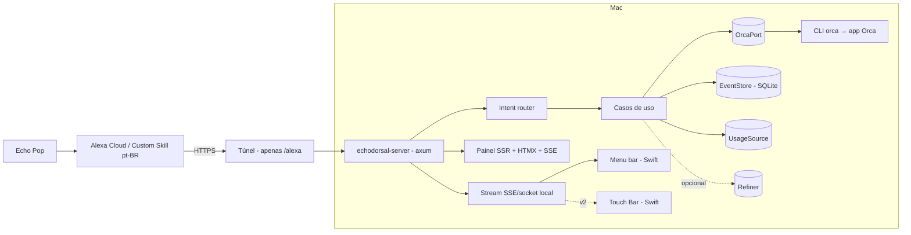

# Arquitetura — echodorsal

## Princípios

- **Hexagonal**: o domínio não conhece I/O. Orca, Alexa, SQLite e provedores de uso entram por portas (traits).
- **Contrato com o Orca isolado** em um único crate, com checagem de versão no startup.
- **Determinístico primeiro**: intents do Alexa mapeiam para casos de uso sem LLM. LLM é opcional e assíncrono.
- **Local-first**: tudo roda no Mac. O único elemento exposto é o endpoint `/alexa`, via túnel.

## Visão de componentes



## Crates

| Crate | Responsabilidade | Depende de |
|---|---|---|
| `echodorsal-domain` | tipos puros: `Project`, `Task`, `TaskStatus`, `Gate`, `UsageWindow`, `Intent`, `VoiceReply`; regras e políticas | — |
| `echodorsal-orca` | `OrcaPort` + `CliOrca` (executa `orca … --json`), parsers tolerantes, checagem de versão | domain |
| `echodorsal-alexa` | modelos de request/response, validação de assinatura/timestamp, builders de SSML, mapeamento intent → comando | domain |
| `echodorsal-store` | `EventStore` em SQLite: eventos, snapshots, auditoria; migrations | domain |
| `echodorsal-usage` | `UsageSource` por provedor (Orca/`agy`/Codex), modelagem de janelas, políticas | domain |
| `echodorsal-refiner` | trait `Refiner`, `NoopRefiner`, `AgyRefiner` (v1.x) | domain |
| `echodorsal-server` | axum: `/alexa`, `/api/*`, `/events` (SSE), painel SSR, assets embutidos | todos |

Regra: dependências apontam para dentro (`domain` não depende de ninguém). Nenhum crate além de `server` conhece `axum`.

## Portas (traits)

```rust
trait OrcaPort {
    async fn status(&self) -> Result<OrcaStatus, OrcaError>;
    async fn worktrees(&self) -> Result<Vec<Worktree>, OrcaError>;
    async fn tasks(&self, filter: TaskFilter) -> Result<Vec<Task>, OrcaError>;
    async fn pending_gates(&self) -> Result<Vec<Gate>, OrcaError>;
    // escrita só existe atrás da flag `writes` (Fase 4):
    async fn create_task(&self, spec: TaskSpec) -> Result<TaskId, OrcaError>;
    async fn resolve_gate(&self, id: GateId, decision: Decision) -> Result<(), OrcaError>;
}
trait EventStore { /* append, query por período, snapshots, auditoria */ }
trait UsageSource { async fn windows(&self) -> Result<Vec<UsageWindow>, UsageError>; }
trait Refiner { async fn refine(&self, input: RawDictation, ctx: ProjectVocabulary) -> Result<RefinedSpec, RefineError>; }
trait Clock { fn now(&self) -> Instant; }   // testes determinísticos
```

## Fluxos

### Consulta por voz (síncrono, < 8 s)

1. Alexa chama `POST /alexa`.
2. Valida assinatura, cadeia, timestamp, `applicationId`, `userId`. Falhou → `401`, sem corpo útil.
3. Intent router → caso de uso → **snapshot em cache** (TTL curto) ou chamada ao `OrcaPort` com timeout de 3 s.
4. `VoiceReply` (≤ 3 frases) → SSML. Meta: p95 < 1,5 s; limite duro 8 s.
5. Orca fechado/ lento → resposta degradada falada (ver `docs/VOICE-UX.md`).

### Eventos (assíncrono)

Um laço supervisionado executa `orca orchestration check --wait` (e, para worktrees, polling espaçado de `worktree ps`),
normaliza para eventos de domínio e grava no `EventStore`. O servidor publica no stream SSE; painel e menu bar apenas assinam.
O histórico ("tarefas anteriores") vem do nosso log, nunca só do estado vivo do Orca.

### Escrita (Fase 4)

Ditado → (opcional `Refiner`) → releitura falada → confirmação (gate ou PIN) → `create_task` → auditoria.
Workers iniciados por voz usam permissões em **modo manual**.

## Modelo de dados (SQLite)

| Tabela | Conteúdo |
|---|---|
| `events` | `id`, `ts`, `kind`, `project`, `task_id?`, `payload_json` (append-only) |
| `snapshots` | último estado conhecido de worktrees/tasks por projeto (para respostas rápidas) |
| `usage_samples` | `ts`, `provider`, `window`, `used_pct`, `resets_at` |
| `voice_audit` | `ts`, `intent`, `slots`, `outcome`, `write?` (sem texto sensível de projetos) |
| `config_kv` | configuração do painel (políticas, nomes de projetos) |

Migrations versionadas; nunca editar migration publicada.

## Configuração e segredos

- `echodorsal.toml` (não versionado; `echodorsal.example.toml` versionado): projetos, allowlist de `userId`, políticas, portas.
- Segredos (PIN falado, token do túnel) no **Keychain do macOS**. Nunca em arquivo, log ou fixture.

## Segurança (modelo de ameaça resumido)

| Ameaça | Mitigação |
|---|---|
| Requisição forjada em `/alexa` | validação completa da requisição Alexa; allowlist de `userId` e `applicationId`; rate limit |
| Painel exposto na internet | bind em `127.0.0.1`; túnel mapeia **somente** `/alexa` |
| Comando de voz mal entendido executando ação | somente leitura por padrão; releitura + confirmação; PIN para ações sensíveis; auditoria |
| Worker iniciado por voz com permissões amplas | modo manual de permissões; o Orca preenche por padrão flags de bypass nos agentes — não herdar |
| Vazamento de contexto de projeto via LLM | `Refiner` desligado por padrão; só vocabulário (nomes), nunca código; limpeza de rastros do `agy` |
| Segredos em logs | `tracing` com redação; testes que falham ao detectar padrões de token |

## Resiliência

- Orca fechado → `OrcaError::NotRunning` → resposta falada "o Orca não está aberto" (+ tentativa opcional de `orca open`, se habilitada).
- Mac dormindo/túnel fora → a skill falha no lado Alexa; documentar no README e monitorar no painel (Sistema).
- Timeouts em tudo (`tokio::time::timeout`); nunca bloquear o handler do Alexa por chamada lenta.

## Desempenho

- Handler do Alexa responde de cache sempre que possível; atualização por laço em segundo plano.
- Menu bar (Swift): sem timers de polling; atualiza ao receber evento; agrupa atualizações (≥ 250 ms).
- Binário único (assets embutidos com `rust-embed`).

## Decisões abertas (resolver via spike + ADR)

1. Fonte de uso: Orca (CLI/UI), `agy -p=/quota`, `/status` do Codex? (F0-06)
2. `agy` headless para o `Refiner`: latência, formato de saída, limpeza de rastros. (F0-07)
3. Tunnel: Cloudflare Tunnel nomeado vs alternativa. (F0-04)
4. Transporte para apps Swift: SSE local vs socket Unix. (Fase 3)
